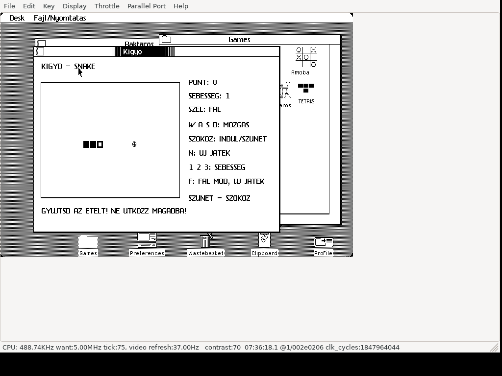

# Kigyo (Snake) for Apple Lisa 2

**Native game for real Apple Lisa 2 hardware running Lisa Office System 3,
including Lisa 2/5 and Lisa 2/10.** The release contains a native Motorola
68000 LOS application. LisaEm is also supported.

Hungarian Snake for Lisa Office System 3, running in a window.
Collect food, grow the snake and avoid your own body. Includes three speeds,
solid or wrapping edges, and automatic pause when switching to another window.
Hungarian captions use unaccented characters for the Lisa font.

## Download and run

Download **[Kigyo.dc42](https://github.com/julyus7/lisa-kigyo/releases/latest/download/Kigyo.dc42)**
from Releases, or [dist/Kigyo.dc42](dist/Kigyo.dc42) using Download raw.
This is a tagged 400 KB Lisa floppy in Disk Copy 4.2 format, **419284 bytes**.
It is an application floppy; boot your own LOS installation first.

### Real Apple Lisa 2

1. Boot Lisa Office System 3 on your Apple Lisa 2.
2. Write `Kigyo.dc42` to a Lisa-format **400 KB 3.5-inch floppy** using a compatible
   disk-image writer and drive. Preserve the native Lisa sector tags in the DC42
   image when writing it. You may also use a floppy replacement that supports
   native Lisa disk images.
3. Insert the prepared floppy into the Lisa, open its disk window, select the
   game tool and choose **File/Print → Open**.
4. To install on your hard disk, use LOS **Duplicate**, then drag the duplicate
   to your Games folder. Keep the floppy inserted until copying completes;
   allow LOS to close the running tool if requested.

The DC42 download is a complete disk image: write it as a disk, rather than
copying the `.dc42` file onto a formatted floppy. Its native Lisa tags are part
of the image. For background on Lisa 2 disk media, see the
[Lisa hardware FAQ](https://lisafaq.sunder.net/lisafaq-hw-media-floppy_wheretobuy.html)
and [Lisa filesystem documentation](https://sunder.net/lisafsh/index.html).

### LisaEm

1. Boot your own Lisa Office System 3 installation in LisaEm.
2. Insert/mount `Kigyo.dc42` as the floppy disk.
3. Open the disk, select the game tool and choose **File/Print → Open**.
4. Use LOS **Duplicate** to install it on the emulated hard disk, keeping the
   floppy inserted until copying completes.

The recorded release tests were performed in LisaEm; a physical Lisa 2 test
has not yet been recorded. See [VALIDATION.md](VALIDATION.md) for the evidence.

The game has its own snake icon, **tool ID 243**, and volume identity ending D604.
It was installed alongside eight existing games without altering their files.
LOS allows only one copy of the same tool per disk; replace an earlier Kigyo
version when updating.

## Controls

| Key | Action |
| --- | --- |
| W / A / S / D | Up / left / down / right |
| Space | Start, pause, resume |
| N | New game, preserving speed and edge mode |
| 1 / 2 / 3 | Slow / medium / fast |
| F | Toggle solid / wrapping edges; restart paused |

The game starts paused. Reverse turns and two direction changes before one
movement tick are rejected. Food gives 10 points and adds one body segment.
Filling the 20 by 14 board wins. Returning from another window leaves it paused;
press Space to resume.

## Source and validation

- [src/M.TEXT](src/M.TEXT): exact released Lisa Pascal source.
- `src/G.TEXT`, `J.TEXT`, `D.TEXT`, `I.TEXT`: supporting LOS units.
- [BUILD.md](BUILD.md): native compilation and packaging instructions.
- [VALIDATION.md](VALIDATION.md): completed checks and their scope.
- [README-HU.md](README-HU.md): magyar leírás és kezelés.
- [CREDITS.md](CREDITS.md): inherited framework and source provenance.

Release checks: 10 host rule checks, 10 native LOS checks, 16 rendering samples,
focus pause, native hard-disk installation and launch after ejecting the floppy.
The installed launch used the same emulator session, not a cold reboot.

Image SHA-256: `618ffb171bcbf230cd0c8fb5e27a10c40edc4405779d6404cfe7ce64b92ad510`.
